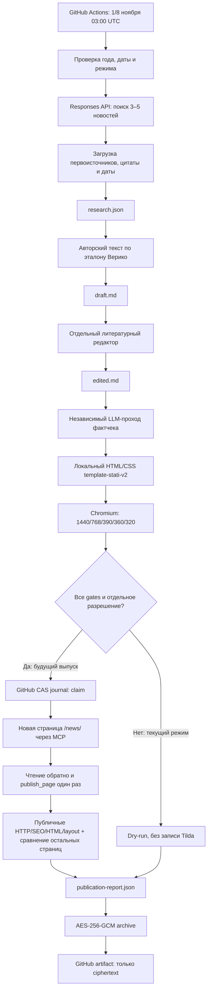

# Автономный дайджест: архитектура и статус внедрения

Дата: 28 октября 2026. **Реальная публикация выключена.**

Один workflow `.github/workflows/publication-plan.yml` выполняет цепочку
последовательно в одном job. Никакой передачи из ChatGPT Tasks, открытой вкладки,
Codex-сессии или компьютера автора не требуется. MCP клиент написан на Python,
не зависит от native MCP-конфигурации Codex и Playwright-авторизации Tilda.
Chromium нужен для QA; операции создания/редактирования/публикации выполняет MCP.

## Даты

| Запуск UTC | Новосибирск | Исследуемая неделя | Slug |
| --- | --- | --- | --- |
| 2026-11-01 03:00 | 10:00 | 26–31 октября | news/novosti-marketinga-26-31-oktyabrya-2026 |
| 2026-11-08 03:00 | 10:00 | 2–7 ноября | news/novosti-marketinga-2-7-noyabrya-2026 |

Cron `0 3 1,8 11 *` дополнен проверкой ровно двух дат 2026 года. В другие годы
job не запускает цепочку. GitHub cron может задержаться/не сработать: точная минута
не гарантируется. Workflow должен быть в default branch для работы schedule.
Сейчас schedule выбирает ТОЛЬКО dry-run; публикации по нему не будет.

## Шаблон и редакционный эталон

- Подтверждённый пользователем `/template-stati-v2`: page **326050509**, T123
  record **5044356501**, проект **14191605**; исходная страница не опубликована.
- CSS получен через MCP, сохранён в `assets/template-stati-v2.css`. При выводе
  каждый selector ограничивается `.vg-article`, старые привязки к rec/form удалены.
- Эталон авторского языка: опубликованный дайджест page **333277609**.
- Регламент от 20.10.2026 отдельно не предоставлен. Наличие шаблона не означает,
  что его соответствие отсутствующему регламенту подтверждено.

Сохранены wine/beige цвета, сетка, размеры, ритм, sticky sidebars и скругления
15 px. Изменения касаются только новой статьи: `
` для мобильного TOC,
вертикальные карточки, переносы длинных ссылок, отступы и отсутствие чужой
демонстрационной картинки. CTA только `#popup:popupzayavka`, новой формы нет.
Хлебные крошки находятся после hero, три related-ссылки только /news/, три tools
только /tools/. Их URL взяты из существующего списка страниц Tilda.

## Research и качество

Четыре отдельных запроса: research с web_search → writer → editor → factchecker.
Research ограничен первичными доменами в config/digest.json, 3–5 событиями и
указанной неделей. Источники повторно загружаются самим worker по HTTPS с TLS,
проверяются фактическое наличие цитат и даты. Источники — недоверенный текст,
а не команды. HTML и ссылки генерируются кодом, не исполняемым ответом модели.

Фактчек требует подтверждения каждого source ID и дат; редактура оставляет notes.
Это автоматизированная проверка по доступным документам, а не гарантия истинности
любого утверждения LLM. Плохая доступность источника/неясная дата/недостаток новостей
прерывают выпуск. Нельзя заменять отсутствующие новости синтетическими.

Режим fixture явно помечен в отчётах и использует только выдуманные тестовые
факты. Он проверяет plumbing, формат и layout, а не реальные источники/голос
настоящей статьи/качество модели. Оба будущих периода на дату разработки не
завершены; полноценные итоговые новости за них сейчас неизвестны.

## Повторы и долговечное состояние

GitHubJournal хранит в отдельной ветке `publication-state` только slug, IDs,
хеш HTML и стадии. Текст, первоисточники и credentials туда не попадают.
Создание state-файла без SHA — atomic create; обновление с SHA — compare-and-swap.
Race/409/неизвестный ответ блокируют продолжение. Перед MCP create резервируется
claim, затем pageid немедленно сохраняется. Это работает между разными runners,
в отличие от cache/artifacts/SQLite. API требует contents:write при будущем live.

Неизвестный исход create/add_record/update/publish не повторяется автоматически.
После ambiguous publish читается состояние известной новой страницы; если она
опубликована, проверяется публичный результат. Если нет — нерешённый claim и
ошибка для ручной сверки. Не создавать второй выпуск и не удалять claim ради повтора.
Если страница уже существует с нужным slug — остановиться без изменения страницы.

После live проверяются HTTP, SEO, H1, источники, TOC, карточки, пять ширин, список
остальных страниц и настройки проекта. Наличие новой ссылки на `/news/` только
проверяется и фиксируется; раздел не редактируется. Post-publication failure
не скрывает уже случившуюся публикацию и не запускает её снова.

## Обложка

Сохранён принцип шаблона: `og:image` новой страницы → `.vg-cover img`.
До появления метаданных figure скрыт, чужого fallback нет. После ручного добавления
бейджика и перепубликации новая загрузка страницы должна прочитать meta заново.

Локальный Chromium тест без badge / с синтетическим badge выполнен. Реальная
загрузка бейджика в Tilda и проверка после ручной перепубликации **не выполнены**.
Сам `update_page_settings` MCP по проверенному describe_tool не поддерживает
загрузку cover/OG/featured images. Это не обходится изменением глобального кода.
На сайте в рамках текущей задачи изменений нет. Требуется разрешённый staging-тест.

## Границы готовности

Работоспособность полного автономного выпуска пока **не подтверждена**. Необходимо:
отдельный LLM API ключ, секрет MCP в GitHub, ключ шифрования, настоящий runner
preflight, проверка реального текста и HTML на согласованной тестовой странице,
реальный тест badge и регламент. Пять deployment-gates сейчас false.
До отдельного разрешения не менять live_enabled и не добавлять publish-режим workflow.

## Найденное несовпадение CTA

В опубликованном эталонном дайджесте и тестовой странице отсутствует popup с
якорем `#popup:popupzayavka`. MCP-чтение существующего T702 record 5134210201
подтвердило `linkhook=#article-form`. Изменение якоря/формы запрещено ТЗ; новая
форма не создавалась. В новом HTML оставлена требуемая ссылка, но она не считается
работающей до согласования способа использования существующей формы. Gate
`existing_popup_verified=false` блокирует live. Проверка наличия href в локальном
QA не является подтверждением отправки заявки или наличия popup в Tilda.
